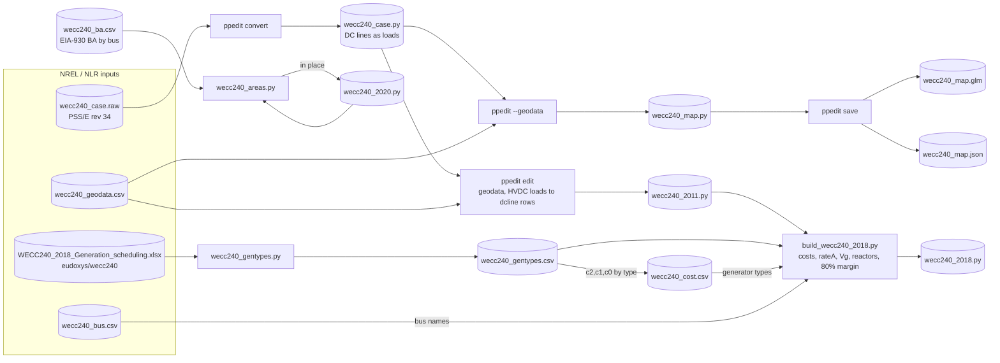

The WECC 240 data was developed from the original WECC 240 PSS/E file
`wecc240_case.raw` originally created by CAISO and redistributed by NLR. This
represents the original 2011 WECC system model [1]. 

The file `wecc240_case.py` is
updated with the `wecc240_*.csv` files from NLR and represents the system as of 2018 [2]. 

The GLM and JSON files currently represent the WECC system using the same model as the PY file (2018 system) but will eventually represent the 2020 system from NLR when it becomes available.

## Data flow

Files are drawn as cylinders and the scripts and ppedit steps that write
them as boxes; an arrow goes from each input to the step that reads it and
from each step to the file it writes. All files except the NREL scheduling
workbook are in this folder.

`wecc240_2018.py` and `wecc240_2020.py` (areas, area names and the geodata
`BA` column) are rebuilt by their scripts, so edit the inputs and rerun the
script rather than editing these case files. The `ppedit` steps are
conversions done once with the editor; there is no script for them.

`wecc240_gentypes.csv` gives PYPOWER polynomial costs (`c2*P^2 + c1*P +
c0`, $/h with `P` in MW) for each generator type, the PSS/E generator ID
in `wecc240_case.raw` (`C` coal steam, `E` steam, `G` gas, `H` hydro, `S`
solar, `W` wind, `N` nuclear, `B` biomass; two-letter IDs are units at
California nodes, e.g. `NG`, `NH`, `NN` for Diablo Canyon). It is derived
from the unit cost curves in NREL's `WECC240_2018_Generation_scheduling.xlsx`
(https://github.com/eudoxys/wecc240, `wecc240/data/`) by

    python3 examples/wecc240/wecc240_gentypes.py WECC240_2018_Generation_scheduling.xlsx

`c1` is the first-segment marginal cost of the type's units; `c2` matches
their variable cost at full output for a unit of the type's median size;
`c0` is 0 (no-load costs are for unit commitment). NREL prices hydro,
wind, solar, geothermal, biomass and the Diablo Canyon unit at 0, and the
case's `Pmax` for them is nameplate capacity, so a single-snapshot OPF
runs them at `Pmax` unless their `Pmax` is first limited to what is
available. `SC` and `ND` (0 MW units) have no NREL curve.

`wecc240_cost.csv` has one polynomial cost row per generator (`id` is the
bus name and PSS/E generator ID), with the `c2,c1,c0` of its type from
`wecc240_gentypes.csv`; start-up and shutdown costs are 0.

In `wecc240_2011.py` the Pacific DC Intertie (CELILO 4010 to SYLMARLA 2619)
and the Intermountain line (INTERMT 2604 to ADELANTO 2600) are DC lines with
zero `dclinecost`. The PSS/E case models them as a load at the rectifier
bus and a negative load at the inverter bus. The DC lines take the same
power at the rectifier (`Pf` 3133.1 and 1845.7 MW) with 3.5% losses
(`loss1` 0.035; `Pt` 3023.4 and 1781.1 MW); the rest of the difference is
load at the inverter bus (526.0 MW at SYLMARLA, 100.3 MW at ADELANTO), so
the power flow solution is unchanged. `Pmax` is `Pf`, there is no reactive
power, and `Vf`, `Vt` are the case voltages.

`wecc240_2018.py` is `wecc240_2011.py` (with its geodata) plus one
polynomial cost row per generator, the costs of its type from
`wecc240_gentypes.csv`, and each branch `rateA` (0 in the source case) set
to its first nonzero `rateB` or `rateC` (0, unlimited, if both are 0).
Bus voltages are then kept at or below 1.087 pu (under the 1.1 pu `Vmax`):
the generators at buses 4039, 4131, 4132, 4231 and 6433 get `Vg` 1.08 pu,
and 1400 MVAr of shunt reactors (`Bs`) are added at buses 2901 (300), 2902
(200), 4002 (100), 4003 (200), 4090 (50), 4091 (50), 4094 (250) and 4097
(250). Last, the 13 rated branches loaded above 80% in that power flow get
`rateA` raised so they are loaded at 80% (a 20% margin), with `rateB` and
`rateC` raised to match where lower (issue #58). Rebuild it after
changing the costs with

    python3 examples/wecc240/build_wecc240_2018.py

In `wecc240_2020.py` the areas are the balancing authorities of EIA Form 930
(issue #90), replacing the four NREL areas. `wecc240_ba.csv` gives the
EIA-930 code of each bus (`BUS_I,NAME,BA,NOTE`, the note saying why), and

    python3 examples/wecc240/wecc240_areas.py

numbers the areas in alphabetical order of the codes, rebuilds the `areas`
rows with their default price reference buses and the code as the area
`name` (issue #93), sets the geodata `BA` column
to the code, and saves `wecc240_2020.py` in place:

| area | BA | name | buses |
|---:|---|---|---:|
| 1 | AESO | Alberta Electric System Operator | 2 |
| 2 | AZPS | Arizona Public Service | 7 |
| 3 | BANC | Balancing Authority of Northern California | 8 |
| 4 | BCHA | BC Hydro | 4 |
| 5 | BPAT | Bonneville Power Administration | 31 |
| 6 | CEN | CENACE (Baja California) | 2 |
| 7 | CISO | California ISO | 106 |
| 8 | IID | Imperial Irrigation District | 2 |
| 9 | IPCO | Idaho Power | 5 |
| 10 | LDWP | Los Angeles Department of Water and Power | 26 |
| 11 | NEVP | Nevada Power (NV Energy) | 8 |
| 12 | NWMT | NorthWestern Energy | 6 |
| 13 | PACE | PacifiCorp East | 16 |
| 14 | PACW | PacifiCorp West | 1 |
| 15 | PNM | Public Service Company of New Mexico | 4 |
| 16 | PSCO | Public Service Company of Colorado | 2 |
| 17 | PSEI | Puget Sound Energy | 2 |
| 18 | SRP | Salt River Project | 4 |
| 19 | SWPW | SPP RTO West (WACM until April 2026) | 4 |
| 20 | WALC | WAPA Desert Southwest | 3 |

A bus is assigned to the balancing authority of the substation or plant it
is named for (by voltage where a station is shared: Four Corners 500 kV is
AZPS and 345/230 kV PNM; Garrison 500 kV is BPAT and 230 kV NWMT; Sylmar
and Cottonwood have a bus per owner). The case's aggregate load buses take
the balancing authority of the station they are placed at, so an area's load
is not that balancing authority's EIA-930 demand: for example, the
northern Washington load at NORTH (PSEI) also serves SCL and TPWR, and BPAT
includes the Portland and Willamette Valley loads of PGE and PACW at
WILLAMET and WCASCADE. Balancing authorities with no bus of their own in the
240-bus case (AVA, CHPD, DOPD, EPE, GCPD, PGE, SCL, TEPC, TIDC, TPWR and the
generation-only ones) have no area. The other example files still have the
NREL areas, including `wecc240_2018.py`.

`wecc240_generation.csv.gz` is a panel of generator `Pmax` by hour for
2020 (UTC, 8,784 hours) for the generator rows of `wecc240_2020.py`: a
`timestamp` column and one column per generator row counted from 1. Read
it on the Multistep tab with *Import ▾ › Panel…* (table gen, value Pmax,
columns are row numbers); with the case's `real_load` and `reactive_load`
series (August 2020) it combines by time into the 744 hours of August; its
August hours are the case's `generation` series. It is built from the WECC 240 node files of eudoxys/generation (`data/wecc`,
2018 to 2022) by

    python3 examples/wecc240/build_wecc240_generation.py GENERATION/data/wecc [--wecc240 WECC240/wecc240/data]

(`--start`, `--end` and `--case` choose other hours or another case with
geodata). Each node's `Pmax` is the operating capacity of the dispatchable
categories other than storage (all but solar, wind, battery and pumped
storage) plus the actual solar and wind net generation, shared among the
node's generators in proportion to their case `Pmax`. The storage
generators (case `Pmin` < 0, the 43 of `wecc240_storage.csv`) have no
column and keep their case `Pmax` (their storage rating): the node storage
capacity is theirs, and the build report compares the two at each node. A generator is at the node with its bus's geohash; a
US generator elsewhere goes to the node its county's generation went to
(wecc240 `county_node_map.csv`, the county named from the bus FIPS code by
wecc240 `counties.csv`). Where a generator's bus is at one node but its
county's generation went to another, the two nodes are pooled: their
`Pmax(t)` is added and shared among the generators of both (see *Fixes for
multistep SOCP OPF* below; the build report lists the 7 pools). The 14
generators in Mexico and Canada have no column and keep their case `Pmax`.

`wecc240_storage.csv` has one `storage` row per `wecc240_2020.py` generator
with a negative `Pmin` (43 rows; they are the case's storage table, and can
be read into another case on the Case tab with *Storage › Import…*). Each storage unit discharges through that generator and charges
through it too (`bus_i` -1, no load charges it). Its rating `Smax` is the
generator's `Pmax`, or `-Pmin` where `Pmax` was 0; those generators are
in service in the case with `Pmax` = `Smax`. Rows 3, 5 and 6 are taken as
pumped hydro: 24 hours of capacity at `Smax`, `eta_ch` 0.8, `eta_dis` 0.9,
no self-discharge, the default aging cost (0.01 $/MWh). The other 40 are
taken as batteries: 4 hours, `eta_ch` and `eta_dis` 0.9, `self_discharge`
0.02 per month, aging 5 $/MWh. Every unit starts and must end half full
(`Es` = `Eend` = `Emax`/2). The case's `generation` series (August of
`wecc240_generation.csv.gz`) has no column for these generators, so their
case `Pmax` holds in every step of a multistep OPF.

`build_wecc240_2020.py` loads the data of `wecc240_2020.py` that comes from
these files and saves the case in place:

    python3 examples/wecc240/build_wecc240_2020.py [CASE] [--check]

It first leaves out the columns of `wecc240_2020_real_load.csv` at buses
outside the US (no county FIPS code in the case geodata: 5003 and 5004),
which keep their case `Pd` (see *Fixes for multistep SOCP OPF* below), and
writes `wecc240_2020_reactive_load.csv` from that real load at
each bus's power factor in the case bus table (`Qd(t) = Pd(t) Qd/Pd`, 0
where the case `Pd` is 0; negative where the case `Qd` is). It then
replaces the storage table with `wecc240_storage.csv` (putting each
storage generator in service with `Pmax` = `Smax`) and all series with
`real_load` (`wecc240_2020_real_load.csv`), `reactive_load`
(`wecc240_2020_reactive_load.csv`) and `generation` (the same hours of
`wecc240_generation.csv.gz`). It then checks that the reactive load follows the real load at the case
power factors, that no load series has a column at a bus outside the US, that each series reads back unchanged from its file, that the three combine by time into the 744 hours
of August with no column in two series, that the panel has no column for a
storage generator, and that the case validates; on a problem it reports it
and does not save. `--check` only runs the checks. Run it after changing
any of those files (after `build_wecc240_generation.py` for the panel).

## Fixes for multistep SOCP OPF

Multistep OPF of `wecc240_2020.py` with the SOCP relaxation (*Run OPF ▾ ›
Multistep OPF › CVXOPF SOCP relaxation*) was infeasible: CLARABEL ended
`infeasible` and every one of the 744 hours was infeasible by itself as a
single-step SOCP OPF, although the case without its series solves (also
with every load scaled down to 60%), and the copper-plate and lossy DC
multistep OPFs solve. Two data problems in the series caused it; the build
scripts now correct both.

1. **British Columbia had almost no load.** `wecc240_2020_real_load.csv`
   is US load (allocated from US counties), but it had a column for bus
   5003 (CA230TO, BC Hydro), which is in Canada: 24 to 32 MW in every hour,
   where the case has 8,803 MW. The other buses outside the US (5001
   BC Hydro, 5002 AESO, 2000 CENACE) have no column and keep their case
   `Pd`. With BC's load (and its reactive load, which follows it) removed, the
   charging of the lightly loaded lines raises the voltages of the British
   Columbia network above `Vmax`, and the generators at 5003 (rows 503 and 512, `Qmin` =
   `Qmax` = 0) cannot absorb reactive power, so no voltage profile within
   the limits exists (widening `Vmax` to 1.3 pu or the generator Q limits
   made those hours feasible; widening branch ratings did not). The DC
   models have no voltages or reactive power, so they still solved.
   `build_wecc240_2020.py` now leaves out the real load columns of buses
   outside the US (and so their reactive load), so 5003 keeps its case
   `Pd` and `Qd` like the other foreign buses, and its check fails if a
   load series has such a column. The real load file itself is unchanged.
2. **Las Vegas generation was moved to Hoover.** The node data of
   eudoxys/generation are county totals placed at the node that
   `county_node_map.csv` gives each county. Clark County, Nevada (Las Vegas,
   with the Harry Allen and Hoover buses) goes to the Hoover/Mead node
   `9qqk6u` (up to 12.7 GW of `Pmax` in August 2020), while the Harry
   Allen node `9qw0kp` gets only Lincoln and Nye counties, Nevada, and
   Washington County, Utah (at most 151 MW in August 2020). The
   generators at bus 1333 (H ALLEN, 3,750 MW in the case) are at `9qw0kp`
   by geohash, so together
   they got 142 MW on average and at most 151 MW (row 277: 3,666 MW in the
   case, about 139 MW in the panel), while the Hoover generators at bus 1331 got about twice
   their case `Pmax`. The southern Nevada load at bus 1303 (up to 5.5 GW
   in August) then had to be imported, mostly over the 1,500 MVA branch
   1302-1303 behind the 1,630 MVA branch 1301-1302, which the SOCP model
   could not do within its branch limits (with the first fix applied,
   hours 0 and 430 were still infeasible, and at hour 0 relaxing just these
   two ratings made it feasible; the lossy DC multistep OPF, with the same
   ratings but no voltages or reactive power, solved). `build_wecc240_generation.py` now
   pools a generator's bus node with the node that holds its county's
   generation: the pooled `Pmax(t)` is the sum of the nodes' and is shared
   among all their generators in proportion to case `Pmax`, so no node
   capacity is lost or moved between counties. Seven node pairs are pooled
   (Los Angeles, San Luis Obispo, Fresno, Clark, Shasta, San Juan and Grant
   counties); in August 2020, row 277 now averages 4,460 MW and rows 271
   and 272 at Hoover about 2,530 MW and 2,660 MW (case 2,079 MW and
   2,188 MW). Pooling instead of moving such generators to their county's
   node keeps the capacity of nodes that would be left with no generator
   (the San Juan node `9we1bp`, up to 568 MW in 2020).

With both fixes the 744-hour multistep SOCP OPF solves (CLARABEL, default
preparation and solver options: about 8 minutes and more than 5 GB of
memory; CLARABEL warns that the solution may be inaccurate), and so do the
lossy DC and
copper-plate multistep OPFs. As single-step SOCP OPFs, 742 of the 744 hours
solve with the default settings; CLARABEL fails numerically (not
`infeasible`) on hours 187 and 466 (2020-08-08 19:00 and 2020-08-20 10:00
UTC), which solve with the `recommended` preparation or with the solver
option `equilibrate_max_iter=50`.

## References

1. J. E. Price and J. Goodin, "Reduced network modeling of WECC as a
   market design prototype," in *2011 IEEE Power and Energy Society General
   Meeting*, 2011, pp. 1-6. (The 2011 model, `wecc240_case.raw` and
   `wecc240_2011.py`.)
2. H. Yuan, R. S. Biswas, J. Tan, and Y. Zhang, "Developing a reduced
   240-bus WECC dynamic model for frequency response study of high renewable
   integration," in *2020 IEEE/PES Transmission and Distribution Conference
   and Exposition (T&D)*, Chicago, IL, USA, Oct. 12-15, 2020. Preprint:
   National Renewable Energy Laboratory, NREL/CP-5D00-74481,
   https://www.nrel.gov/docs/fy21osti/74481.pdf. (The 2018 model,
   `wecc240_2018.py`: the generation resource mix of the Western
   Interconnection as of 2018.)
